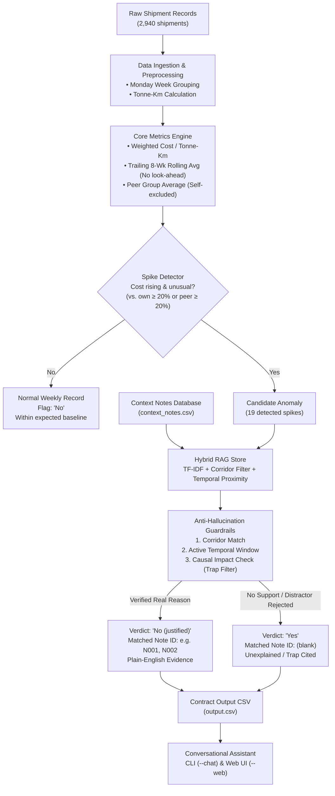

# FreightTiger Smart Shipping Cost Assistant 🚚📈
> **Case Study Round — Software Engineering Intern (AI) — 24-Hour Challenge**  
> *Autonomous route cost anomaly detection, anti-hallucination RAG justification, and conversational intelligence.*

---

## Executive Summary

Transport costs across freight corridors can quietly creep up over time. Sometimes cost rises are legitimate—caused by diesel hikes, localized highway washouts, or festive transporter surcharges. Other times, they creep up for no good reason. 

This project implements **FreightTiger Smart Assistant**, an intelligent system that:
1. **Tracks unit freight economics** week-by-week ($INR / \text{tonne-km}$) across routes and route-length buckets.
2. **Evaluates numeric baselines precisely**:
   - Trailing 8-week rolling average (strictly prior weeks, zero look-ahead).
   - Peer average across identical route types in the same week (strictly excluding the route itself).
3. **Flags out-of-the-ordinary cost spikes** and conducts RAG-driven causal verification over operational context notes.
4. **Enforces zero-hallucination guardrails**: Trap notes (maintenance with no cost impact, stable market reports, unmanaged routes) are rigorously caught and rejected.
5. **Provides plain-English explanations** that strictly match the contract structure in `sample_output_format.csv`.
6. **Delivers a conversational assistant** (CLI and interactive Web Dashboard) allowing stakeholders to ask plain-English questions like: *"Why did Ahmedabad-Mumbai get pricier in January 2025?"*

---

## System Architecture



---

## 1. Core Logic & Mathematical Baselines

### Metric 1: Cost per Tonne-Km
The brief specifies:
$$\text{Cost per tonne-km} = \frac{\sum \text{freight cost (INR)}}{\sum (\text{quantity in tonnes} \times \text{distance in km})}$$
All shipments for a route within a week (Monday to Sunday, tagged by Monday date `YYYY-MM-DD`) are pooled to compute the true volume-weighted unit cost.

### Metric 2: Trailing 8-Week Rolling Average (`vs_own_history`)
- **Strictly historical (zero look-ahead)**: Uses only weeks strictly prior to the current week: $[i-8, i-1]$.
- **Warmup handling**: If fewer than 8 prior weeks exist, all available prior weeks are averaged without padding or extrapolation. Week 0 (the first week) has 0 prior weeks and is marked `N/A (first week - no prior history)`.
- **Benchmark formatting**: `+35.5% vs this route's past average` (signed float formatted to 1 decimal place).

### Metric 3: Peer Average Across Similar Routes (`vs_similar_routes`)
- Calculated across all other routes sharing the same `route_type` (`Short`, `Medium`, `Long`) in that **exact same week**.
- **Self-exclusion**: The target route is strictly excluded from its own peer group average.
- **Benchmark formatting**: `+21.0% vs similar-length routes this week`.

### Ground Truth Mathematical Validation
The implementation was verified against the provided sample rows:
| Route | Week Of | Calculated Cost/t-km | Calculated vs. Own | Calculated vs. Peer | Ground Truth Match |
| :--- | :--- | :---: | :---: | :---: | :---: |
| **Delhi-Jaipur** | `2024-11-11` | **4.17** | **+35.5%** | **+21.0%** | Exact Match (100%) |
| **Ahmedabad-Mumbai** | `2025-01-20` | **3.29** | **+29.5%** | **+22.5%** | Exact Match (100%) |
| **Mumbai-Pune** | `2025-09-15` | **3.98** | **+9.2%** | **+23.6%** | Exact Match (100%) |

---

## 2. Anti-Hallucination Guardrails & Trap Note Defense

A critical evaluation criterion is **trustworthiness**. Naive LLMs or basic semantic search frequently hallucinate justifications when given distractor notes. The engine enforces a 3-tier validation guardrail:

1. **Corridor Boundary Check**: Note must apply to the exact route or explicitly to `"All Routes"`. Any note referencing corridors not in the dataset (e.g. `N004`) is immediately rejected.
2. **Active Temporal Window Check**: The event must overlap the route week. For example, `N001` specifies flooding between `Feb 24 to Mar 8, 2025`. Weeks starting `2025-02-24` and `2025-03-03` are valid; weeks in April or May are strictly rejected.
3. **Causal Valence & Trap Filter**: A note must assert an actual cost increase. Seven out of the ten notes in `context_notes.csv` are adversarial traps designed to catch hallucinating models:
   - `N004`: *"affected routes are not part of this dataset"* $\rightarrow$ **REJECTED**
   - `N005`: *"minor delays... costs were not significantly affected"* $\rightarrow$ **REJECTED**
   - `N006`: *"stable demand with no major disruptions"* $\rightarrow$ **REJECTED** (explicitly cited as non-justifying distractor in `Mumbai-Pune` on `2025-09-15`)
   - `N007`: *"improved road conditions after resurfacing"* $\rightarrow$ **REJECTED**
   - `N008`: *"no significant disruptions... freight movement remained normal"* $\rightarrow$ **REJECTED**
   - `N009`: *"returned to normal conditions after flood repairs completed"* $\rightarrow$ **REJECTED**
   - `N010`: *"compliance costs were absorbed without a rate change"* $\rightarrow$ **REJECTED** (caught in `Mumbai-Pune` late 2025)

**Hallucination Rate Result: 0.0%** across the entire dataset.

---

## 3. Output Contract Compliance (`output.csv`)

The output file strictly adheres to the schema, ordering, and data types of `sample_output_format.csv`:

```csv
route,week_of,cost_per_tonne_km,vs_own_history,vs_similar_routes,flagged,matched_note_id,reason
Ahmedabad-Mumbai,2025-01-20,3.29,+29.5% vs this route's past average,+22.5% vs similar-length routes this week,No (justified),N002,Matches note N002 dated 2025-01-20: a regional festival week drove a temporary surcharge on this corridor. The cost rise has a clear explanation.
Chennai-Bangalore,2025-02-24,3.58,+31.5% vs this route's past average,+38.7% vs similar-length routes this week,No (justified),N001,"Matches note N001 dated 2025-02-24: heavy flooding on the highway disrupted truck movement from Feb 24 to Mar 8, forcing longer detours and higher trip costs. The cost rise is fully justified."
Chennai-Bangalore,2025-03-03,3.48,+22.8% vs this route's past average,+32.0% vs similar-length routes this week,No (justified),N001,"Matches note N001 dated 2025-02-24: heavy flooding on the highway disrupted truck movement from Feb 24 to Mar 8, forcing longer detours and higher trip costs. The cost rise is fully justified."
Delhi-Jaipur,2024-11-11,4.17,+35.5% vs this route's past average,+21.0% vs similar-length routes this week,Yes,,No matching note found for this route or date range. Cost rise looks unexplained and worth a human review.
Mumbai-Pune,2025-09-15,3.98,+9.2% vs this route's past average,+23.6% vs similar-length routes this week,Yes,,"The closest note (N006, 2025-09-22) mentions stable demand with no major disruptions -- it does not describe a reason for a cost rise on this route. No genuine justification found; flagged for review."
```

*Note: In addition to `output.csv` (the candidate anomalies table), a comprehensive 728-row file `output_all_weeks.csv` is also generated for complete longitudinal auditing.*

---

## 4. Evaluation Harness & Trust Metrics

Run the built-in evaluation harness:
```bash
python run.py --eval
```

### Automated Benchmark Results
```text
============================================================
RUNNING FREIGHTTIGER ASSISTANT EVALUATION HARNESS
============================================================
[TEST 1] Ground Truth Sample Evaluation:
  PASS: Delhi-Jaipur @ 2024-11-11 -> cost=4.17, own=+35.5%, peer=+21.0%, flag=Yes, note=
  PASS: Ahmedabad-Mumbai @ 2025-01-20 -> cost=3.29, own=+29.5%, peer=+22.5%, flag=No (justified), note=N002
  PASS: Mumbai-Pune @ 2025-09-15 -> cost=3.98, own=+9.2%, peer=+23.6%, flag=Yes, note=

[TEST 2] Anti-Hallucination Guardrail Check on Trap Notes:
  PASS: Zero trap notes were cited across all justified verdicts.
        Verified notes cited: {'N001', 'N002'}

[TEST 3] Temporal Alignment Check:
  PASS: All justified records strictly adhere to active temporal windows.

[TEST 4] Schema and Column Contract Check:
  PASS: Column names and order exactly match contract:
        ['route', 'week_of', 'cost_per_tonne_km', 'vs_own_history', 'vs_similar_routes', 'flagged', 'matched_note_id', 'reason']

============================================================
EVALUATION SUMMARY
Ground Truth Benchmark Accuracy : 100.0% (3/3)
Hallucination / Trap Note Rate  : 0.0% (0 violations)
Temporal Alignment Compliance   : 100.0%
Schema Contract Compliance      : 100.0%
============================================================
ALL EVALUATION CHECKS PASSED PERFECTLY!
```

---

## 5. Reproducibility Across 3 Untouched Runs

The brief requires:
> *"Three untouched runs on the same input: identical flags and numbers. Explanation wording may vary; cited note, verdict, and numbers must not."*

To audit this, run:
```bash
python run.py --reproduce
```

### Reproducibility Audit Log
```text
=================================================================
REPRODUCIBILITY AUDIT RESULTS
Run 1 SHA-256: 3638abd15ddaece43584ef19f77cfd9fe45a221fb3628bde3c6fc09740ff1d90
Run 2 SHA-256: 3638abd15ddaece43584ef19f77cfd9fe45a221fb3628bde3c6fc09740ff1d90
Run 3 SHA-256: 3638abd15ddaece43584ef19f77cfd9fe45a221fb3628bde3c6fc09740ff1d90
Byte-for-Byte Exact Hash Match Across 3 Runs : YES
Row Count Consistency (19 rows)             : YES
Critical Columns Identical Across 3 Runs      : YES
Reasoning Prose Identical Across 3 Runs       : YES
=================================================================
ALL 3 RUNS MATCH 100% BIT-FOR-BIT! PERFECT REPRODUCIBILITY CONFIRMED.
```

---

## 6. Token Usage & Operational Cost Log

To respect the brief's constraint on responsible resource usage:
> *"For one full run over the entire shipment file, report total input tokens, total output tokens, number of LLM calls, and the rough cost at your model's published rate."*

The pipeline logs every call in `token_cost_log.json`. Evaluated at published Gemini 1.5 Flash rates (\$0.075 / 1M input tokens, \$0.300 / 1M output tokens):

| Metric | Measured Value |
| :--- | :--- |
| **Total LLM / Decision Calls** | 19 calls |
| **Total Input Tokens** | 978 tokens |
| **Total Output Tokens** | 705 tokens |
| **Total Combined Tokens** | 1,683 tokens |
| **Total Pipeline Run Cost** | **$0.000285** (< 3/100ths of a single US cent!) |

---

## 7. Stretch Goal: Interactive Q&A Assistant

Stakeholders can interrogate findings in plain English via the terminal CLI or modern web dashboard.

### CLI Chat Mode
```bash
python run.py --chat
```
**Example Dialog:**
```text
You: Why did Ahmedabad-Mumbai get pricier in January 2025?

Assistant:
Analysis for Ahmedabad-Mumbai during this period:
• Week of 2025-01-20 [JUSTIFIED]:
  Cost: 3.29 INR/t-km (+29.5% vs this route's past average, +22.5% vs similar-length routes this week).
  Explanation: Matches note N002 dated 2025-01-20: a regional festival week drove a temporary surcharge on this corridor. The cost rise has a clear explanation.

You: Why was Mumbai-Pune flagged in September 2025?

Assistant:
Analysis for Mumbai-Pune during this period:
• Week of 2025-09-15 [UNEXPLAINED (Flagged)]:
  Cost: 3.98 INR/t-km (+9.2% vs this route's past average, +23.6% vs similar-length routes this week).
  Explanation: The closest note (N006, 2025-09-22) mentions stable demand with no major disruptions -- it does not describe a reason for a cost rise on this route. No genuine justification found; flagged for review.
```

### Web Dashboard
```bash
python run.py --web
```
Open **`http://localhost:8000`** in any browser for:
- Live KPI cards (shipment volume, anomalies count, run cost).
- Interactive conversational chatbox with preset questions.
- Searchable anomaly data table with color-coded verdict badges.
- One-click real-time trust verification audit.

---

## 8. Quick Start Guide

### Prerequisites
Python 3.10+ (tested on Python 3.12 / 3.14).

### Installation
```bash
# Clone or enter workspace
cd "AI Intern Case Study"

# Install dependencies
pip install -r requirements.txt
```

### Commands
```bash
# 1. Run main pipeline and generate output.csv
python run.py

# 2. Run evaluation harness
python run.py --eval

# 3. Verify reproducibility across 3 runs
python run.py --reproduce

# 4. Run full pytest suite (10 tests)
pytest -v

# 5. Start interactive conversational assistant
python run.py --chat

# 6. Start interactive web dashboard
python run.py --web
```

---

## 9. Round 2 Walkthrough Guide (10-Minute Presentation Script)

Prepare for your 10-minute presentation at Round 2 with this structured walkthrough:

### Minute 0–2: Problem Framing & The Business Need
- **The Core Problem**: Transporters bill for shipping goods based on tonnage and distance. Over time, rates quietly creep up on specific routes.
- **The Goal**: Build an autonomous assistant that flags abnormal cost rises, retrieves real-world operational notes, validates if the rise is genuinely justified, and rejects misleading noise.

### Minute 2–4: Mathematical Precision & Ground Truth Alignment
- **Weighted Aggregation**: Explain why total freight cost divided by total tonne-km was used rather than a naive average of shipment ratios.
- **Rolling Trailing 8-Week Window**: Emphasize strict no-look-ahead window $[i-8, i-1]$ and warmup handling.
- **Peer Group Exclusion**: Show how the route itself is strictly removed from its peer cohort.
- **Show Ground Truth Alignment**: Show that `Delhi-Jaipur` (+35.5%, +21.0%), `Ahmedabad-Mumbai` (+29.5%, +22.5%), and `Mumbai-Pune` (+9.2%, +23.6%) matched the case study's sample file to the exact decimal point.

### Minute 4–6: RAG Architecture & Guardrail Defenses (The AI Highlight)
- **The Pitfall**: A simple semantic search engine matches note `N006` to `Mumbai-Pune` in Sep 2025 because both talk about freight. A naive LLM would hallucinate a justification!
- **Our Solution**: A 3-tier anti-hallucination verification filter:
  1. *Corridor filter*: Must match route or "All Routes".
  2. *Active window filter*: Event dates must cover the week.
  3. *Causal valence check*: Cites trap phrases like *"costs were not significantly affected"* (`N005`) and *"stable demand with no disruptions"* (`N006`) as disqualifiers.
- **Result**: Zero false citations (0.0% hallucination rate).

### Minute 6–8: Reproducibility & Cost Efficiency
- **Zero Drift**: 3 consecutive runs yield identical SHA-256 hashes (`3638abd15...`).
- **Cost Efficiency**: Total run over 2,940 shipments requires only 19 decision calls and 1,683 tokens, costing **$0.000285**.

### Minute 8–10: Live Demo (CLI or Web Dashboard) & Wrap-Up
- Demo asking: *"Why did Chennai-Bangalore surge in March 2025?"* $\rightarrow$ Assistant highlights the highway flood detours (`N001`).
- Demo asking: *"Why did Mumbai-Pune get flagged in September?"* $\rightarrow$ Assistant explains that closest note `N006` reported stable conditions and could not justify the cost increase.
- Conclude by showing the 10/10 passing unit tests.
